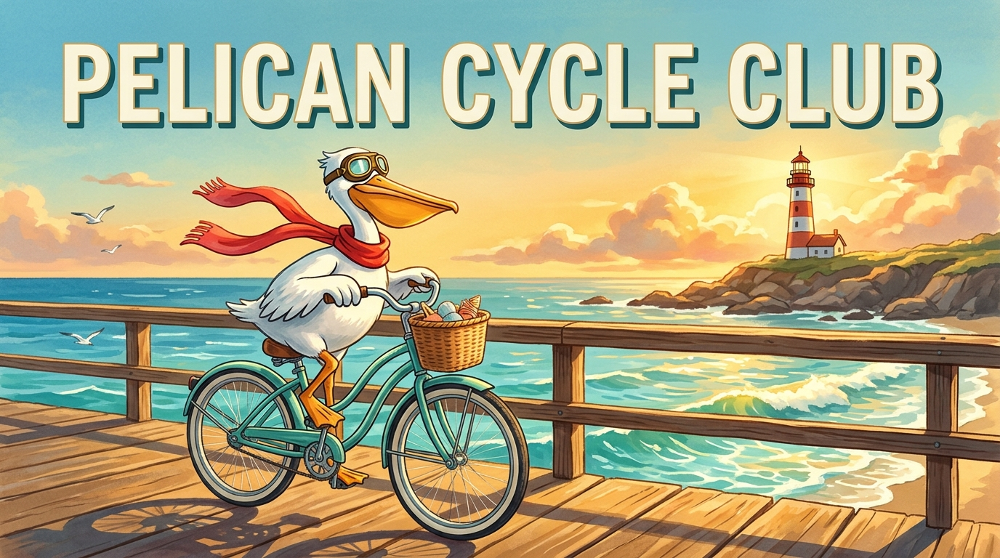

# 鹈鹕环海骑行 3D · Pelican Cycle Club



一个融合多项前端 3D 与交互技术的实时 WebGL 海岸骑行体验：

- **精确解析 2-Bone IK 蹬踏系统**：鹈鹕的橙色双腿与三趾蹼足实时锁定旋转脚踏，膝关节随踏频自然弯曲。
- **博物馆级海沫绿复古巡洋舰自行车**：完整机械传动（齿盘、飞轮、动态滚动链条、水平自保持脚踏、24 根交叉钢辐条、防滑无打滑轮速计算、可转向倾斜前叉、编织前车篮、黄铜车铃、夜间光锥前照灯）。
- **富有表现力的 3D 鹈鹕**：羽纹 PBR 材质、黄铜飞行员护目镜、风速响应式飘动红围巾、自然眨眼与视线追踪、可张合大嘴与弹性喉囊、随翘头/冲刺动态展开扇动的双翼。
- **自定义 GLSL 着色器海岸世界**：瑞利/米氏大气天空穹顶（支持黄金时刻 / 晴朗正午 / 瑰丽晚霞 / 星夜灯塔平滑切换）、多层波浪与海岸泡沫动态海洋、无限滚动木栈道与旋转光束灯塔、互动飞鱼投喂与海鸥群。
- **全程序化 Web Audio 音效引擎**：零外部音频文件，实时合成海浪、风声、黄铜车铃、机械踏频滴答、鹈鹕鸣叫、水花吞咽及海岸马林巴旋律。
- **一键拍摄 3D 海岸明信片**：内置 `ACESFilmic` 色调映射与 `UnrealBloomPass` 辉光后期，支持随时截取并下载带复古邮戳边框的高清明信片。

## 本地运行

```bash
npm install
npm run dev
```

## 生产构建

```bash
npm run build
```
